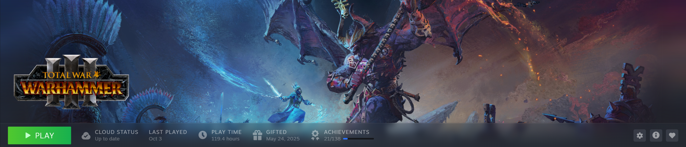
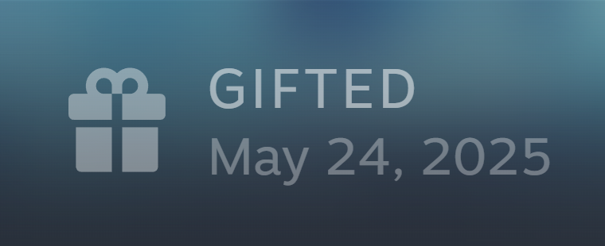
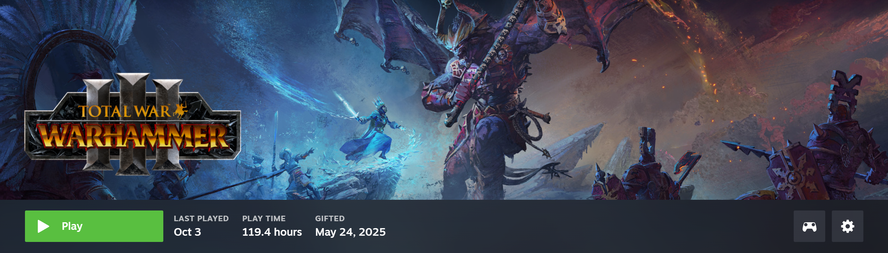
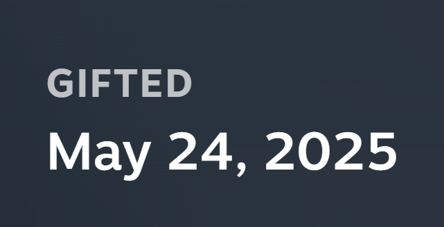
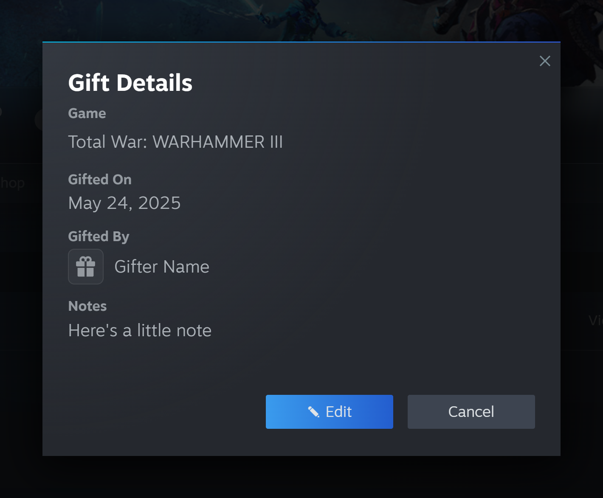
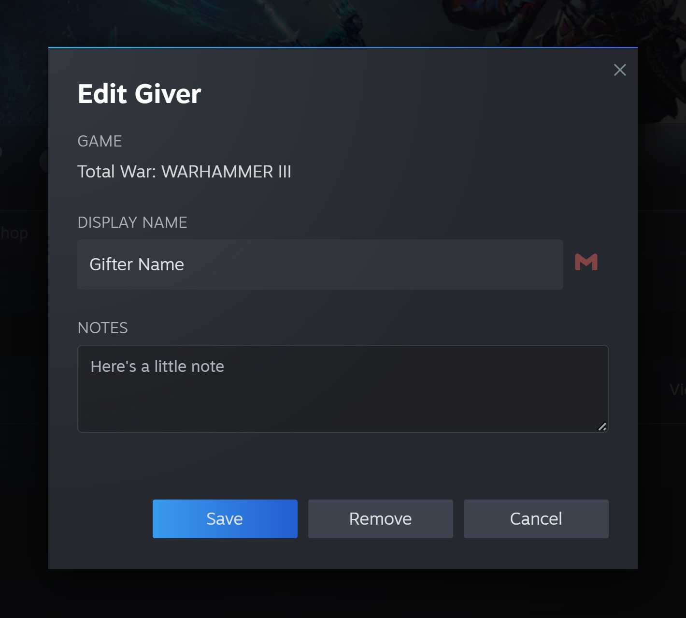
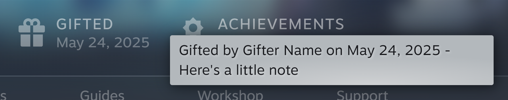

# Gratitude - Gifted Games Reminder

**Gratitude** is a [Millennium](https://steambrew.app/) plugin for your Steam Library that adds a helpful indicator to games you have been gifted.

## Screenshots

  
   
  <em>The plugin integrates seamlessly with the existing Steam game header.</em>

  

### Big Picture Mode

Gratitude also works in Big Picture mode, providing the same gift information when browsing your library on the big screen.

  
   
  <em>Full Big Picture mode support for couch gaming.</em>

  

### Gift Labeling
Ever forgotten who gave you a game?

| | |
|:---|:---:|
| Click the Gifted label on any gifted game to open a details panel where you can record the gifter and add a personal note. (Clicking the gift icon itself has a little surprise.) |  |
|  | The gifter field suggests people from your Steam friends list as you type, so you can find the right person without typing their full name. Not sure who it was? The Gmail button searches your inbox for Steam's gift email. |
| Once saved, the gifter's name shows up right in the tooltip so you never forget again! |  |

## 🛠 Installation

> [!IMPORTANT]
> **Millennium is required.** This plugin will only work if you have the Millennium framework installed. If you haven't, visit [steambrew.app](https://steambrew.app/) first.

### Either: 
1.  **Install from the Gratitude plugin page:**
    * Open [Gratitude on steambrew.app](https://steambrew.app/plugin?id=a0f319c49e93).
    * Use the install flow there. This is the recommended way to install the plugin.

Or:
1.  **Manual install fallback:**
    * Click the **Releases** section on the right side of this repository.
    * Under the latest version, look for the **Assets** dropdown.
    * Download the file named `gratitude-for-millenium-<version>.zip`.
2.  **Locate Plugins Directory:**
    * Go to the `millennium\plugins` folder in your Steam installation (often `C:\Program Files (x86)\Steam\millennium\plugins`).
    * *Note: This folder is only created after Millennium has been installed and run for the first time.*
3.  **Extract:**
    * Extract the contents of the ZIP file into a new folder within that `plugins` directory.
4.  **Restart Steam (if it was open):**
    * Once Steam restarts, Millennium will load the plugin but it still needs to be enabled.
5.  **Enable the Plugin:**
    * Go to **Steam** → **Millennium** → **Plugins** in the menu bar.
    * Find **Gratitude** in the list and toggle it on.
    * "Save Changes"

---

# FAQ
**Q: Is Millennium allowed by Valve? (Will I get banned?)**   
A: Using Millennium to customize your client is safe. As noted on the [Official Valve Software Wiki](https://developer.valvesoftware.com/wiki/Steam_Skins):   
> "As the official skin support (for VGUI) has been removed... it was unofficially replaced by Millennium for Steam... an open source patcher that allows skins/themes after April 27th 2023."

**Q: Does this work in Big Picture mode?**  
A: Yes! Gratitude fully supports both the standard Steam library and Big Picture mode.

**Q: Why isn't the gift display loading or isn't showing for a game I was just gifted?**  
A: Gratitude reads your license list from the Steam Store, so open the Store in the Steam client, wait a moment, then go back to your Library. It checks for new licenses in the background at most every 10 minutes. A game Gratitude has no license data for shows a question mark instead, which you can click to sync.

**Q: Can it show who gifted me the game?**  
A: Yes, with a little help from you! Steam doesn't store sender information in a way the client can retrieve, but you can label it yourself. Click the `Gifted` label on any gifted game in your Library to open the details panel, where you can select the gifter from your Steam friends list and add a personal note. Once saved, the gifter's name will appear in the tooltip.

## Acknowledgments

A special thanks to **[HLTB for Millennium](https://github.com/jcdoll/hltb-millennium-plugin)** for executing another plugin which places game-specific tooltips: it made a great study/starting out point, especially for the observer and injection logic.

This project uses the **IoGiftSharp** icon from **[Ionicons](https://ionic.io/ionicons)** via **[react-icons](https://react-icons.github.io/react-icons/)**.  
Ionicons and react-icons are licensed under the **MIT License**.
