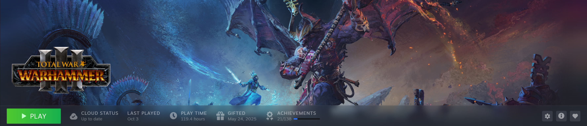
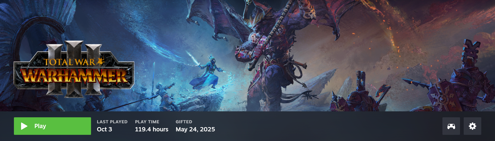
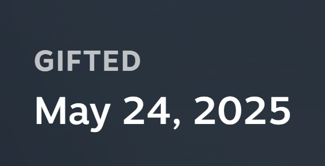
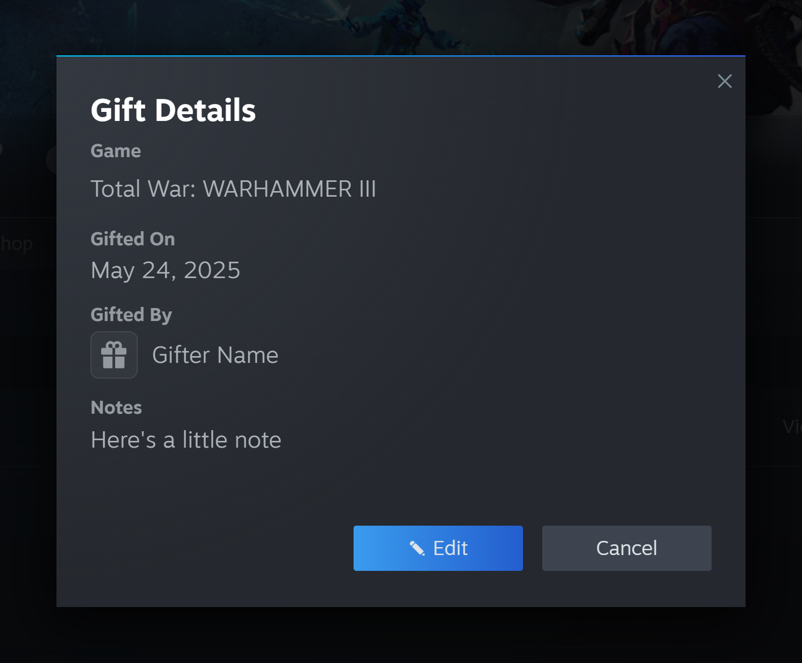
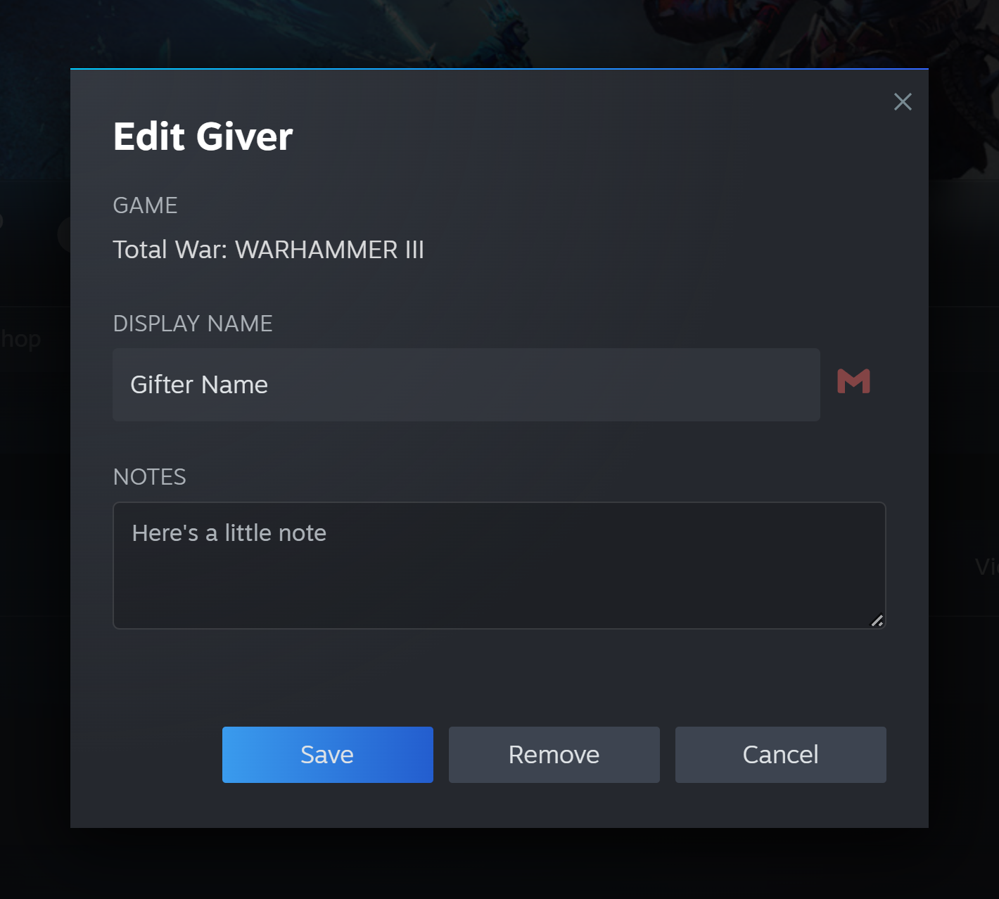
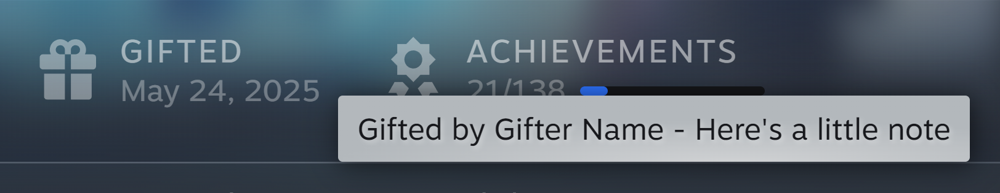

# Gratitude - Gifted Games Reminder
_Now in 30 languages!_

  

**Gratitude** is a [Millennium](https://steambrew.app/) plugin for your Steam Library that adds a helpful indicator to games you have been gifted.

## Screenshots

  
   
  <em>The plugin integrates seamlessly with the existing Steam game header.</em>

  

### Big Picture Mode

Gratitude also works in Big Picture mode, providing the same gift information when browsing your library on the big screen. The Gifted badge works with a controller and keyboard too, and screen readers read it as a button.

  
   
  <em>Full Big Picture mode support for couch gaming.</em>

  

### Gift Labeling
Ever forgotten who gave you a game?

| | |
|:---|:---:|
| Click the Gifted label on any gifted game to open a details panel where you can record the gifter and add a personal note. (Clicking the gift icon itself has a little surprise, so turn your sound on.) |  |
|  | The gifter field suggests people from your Steam friends list as you type, so you can find the right person without typing their full name. Not sure who it was? The Gmail button opens Gmail in Steam's browser with a search for Steam's gift email already typed in. Gratitude only fills in the search box: it can't read your email, and you see the results yourself. |
| Once saved, the gifter's name shows up right in the tooltip so you never forget again! |  |

### Gifters Filled In For You 

Gifts you received before about 2019 went through your Steam inventory, and Steam's inventory history still records who sent each one. Gratitude reads it once, in the background, a couple of minutes after Steam starts, and fills in the gifter for each of those games. It only looks around the dates of your older gifts, so it usually takes about a minute and you won't notice it running. It never replaces a gifter you entered, and if you delete one it filled in, it stays deleted. The **Find gifters** button in Gratitude's settings searches again.

Steam stopped recording the sender for newer gifts, so for those, the details panel above is the way to record who gave it.

### Language Support 

Gratitude follows the language your Steam client is set to, in all 30 of Steam's languages, and shows gift dates the way your language writes them.

Spotted something that reads wrong in your language? The phrases live in [`lib/i18n/locales`](lib/i18n/locales), and corrections are very welcome.

## 🛠 Installation

> [!IMPORTANT]
> **Millennium is required.** This plugin will only work if you have the Millennium framework installed. If you haven't, visit [steambrew.app](https://steambrew.app/) first.

### Either: 
1.  **Install from the Gratitude plugin page:**
    * Open [Gratitude on steambrew.app](https://steambrew.app/plugin?id=a0f319c49e93).
    * Use the install flow there. This is the recommended way to install the plugin.

Or:
1.  **Manual install fallback:**
    * Click the **Releases** section on the right side of this repository.
    * Under the latest version, look for the **Assets** dropdown.
    * Download the file named `gratitude-for-millenium-<version>.zip`.
2.  **Locate Plugins Directory:**
    * Go to the `millennium\plugins` folder in your Steam installation (often `C:\Program Files (x86)\Steam\millennium\plugins`).
    * *Note: This folder is only created after Millennium has been installed and run for the first time.*
3.  **Extract:**
    * Extract the contents of the ZIP file into a new folder within that `plugins` directory.
4.  **Restart Steam (if it was open):**
    * Once Steam restarts, Millennium will load the plugin but it still needs to be enabled.
5.  **Enable the Plugin:**
    * Go to **Steam** → **Millennium** → **Plugins** in the menu bar.
    * Find **Gratitude** in the list and toggle it on.
    * "Save Changes"

---

# FAQ
**Q: Is Millennium allowed by Valve? (Will I get banned?)**   
A: Using Millennium to customize your client is safe. As noted on the [Official Valve Software Wiki](https://developer.valvesoftware.com/wiki/Steam_Skins):   
> "As the official skin support (for VGUI) has been removed... it was unofficially replaced by Millennium for Steam... an open source patcher that allows skins/themes after April 27th 2023."

**Q: Does this work in Big Picture mode?**  
A: Yes! Gratitude fully supports both the standard Steam library and Big Picture mode.

**Q: Why isn't the gift display loading or isn't showing for a game I was just gifted?**  
A: Gratitude reads your licenses from the Steam client and checks them again every 10 minutes, so a new gift shows up by itself after a little while, or straight away after restarting Steam. For anything the client's list can't answer, it falls back to your licenses page on the Steam Store: open the Store in the Steam client, wait a moment, then go back to your Library.

**Q: Can it show who gifted me the game?**  
A: Yes. For gifts received before about 2019, Gratitude fills in the gifter for you from your Steam inventory history (see Gifters Filled In For You above). For newer gifts Steam doesn't keep the sender anywhere Gratitude can read, but you can label them yourself: click the `Gifted` label on any gifted game in your Library to open the details panel, where you can pick the gifter from your Steam friends list and add a personal note. Once saved, the gifter's name appears in the tooltip.

**Q: Does the background search slow Steam down?**  
A: Not noticeably. It runs once, opens one hidden Steam web page for about a minute, and reads a page of your inventory history every few seconds. In testing it used about 40 MB of memory and under 1% CPU, and Store and Community pages loaded just as fast while it ran. Accounts with no gifts from before 2020 skip it entirely.

**Q: Can I turn the sound off?**  
A: Yes: turn off **Party sounds** in Gratitude's settings. The confetti stays.

## Acknowledgments

A special thanks to **[HLTB for Millennium](https://github.com/jcdoll/hltb-millennium-plugin)**, another plugin that places game-specific tooltips: it was a great starting point to learn from, especially for the observer and injection logic.

This project uses the **IoGiftSharp** icon from **[Ionicons](https://ionic.io/ionicons)** via **[react-icons](https://react-icons.github.io/react-icons/)**.  
Ionicons and react-icons are licensed under the **MIT License**.

The party popper and party horn sounds are from **[Freesound](https://freesound.org)**: [Balloon Pop / Christmas cracker / Confetti Cannon](https://freesound.org/people/Breviceps/sounds/458398/) by Breviceps and [Party horn.wav](https://freesound.org/people/audiosmedia/sounds/170583/) by audiosmedia, both released into the public domain (CC0).
